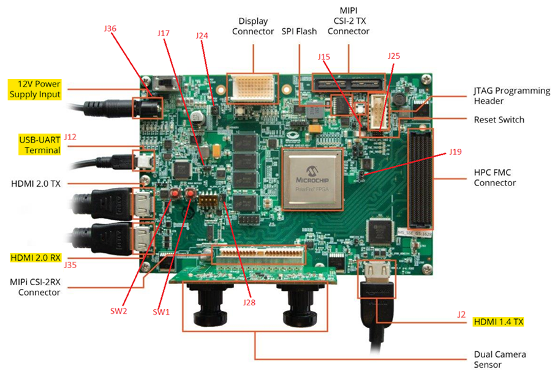

# VectorBlox 3.2 PolarFire&reg; Non-SoC Video Kit Getting Started Guide

This guide provides step-by-step instructions for setting up the PolarFire Video Kit and running the VectorBlox demo. Complete the prerequisites, then follow the board setup steps. Finally, refer to the "Controlling the VectorBlox Demo" section for instructions on operating the demo.

## Table of Contents

- [Prerequisites](#prerequisites)
- [Board Setup](#board-setup)
  - [Step 1: Jumper Settings](#step-1-jumper-settings)
  - [Step 2: Hardware Connections](#step-2-hardware-connections)
  - [Step 3: Program the Video Kit](#step-3-program-the-video-kit)
  - [Step 4: Run the Demo](#step-4-run-the-demo)
- [Controlling the VectorBlox Demo](#controlling-the-vectorblox-demo)
- [Troubleshooting](#troubleshooting)
- [Next Steps](#next-steps)

## Prerequisites

Before starting, **install the [FTDI Drivers](https://ftdichip.com/Drivers/) on your host PC and install [FlashPro Express](https://www.microchip.com/en-us/products/fpgas-and-plds/fpga-and-soc-design-tools/programming-and-debug#Download%20Software)**. The video kit is programmed over the included USB-A to mini-B cable through the onboard FTDI chip, so no external programmer is needed.

<b>Software Prerequisites</b>

| Software | Purpose |
| :------- | :------ |
| [FlashPro Express](https://www.microchip.com/en-us/products/fpgas-and-plds/fpga-and-soc-design-tools/programming-and-debug#Download%20Software) | Required to program the prebuilt job file to the video kit. Can be installed as a standalone tool with the Program and Debug tools; also included with Libero SoC. |
| [FTDI drivers](https://ftdichip.com/Drivers/) | USB-to-UART and programming drivers for the host PC. |
| [Serial terminal](https://onlinedocs.microchip.com/oxy/GUID-E89F0380-CE10-4E39-B622-CA56F677F477-en-US-3/GUID-252CFF5A-1DB8-421F-B210-A5C575B68FE7.html) | Optional. The Mi-V application prints start-up and error messages over UART (e.g., PuTTY or MobaXterm). Settings are 115200 baud, 8 data bits, no parity, 1 stop bit, and no flow control. |
| [Libero SoC](https://www.microchip.com/en-us/products/fpgas-and-plds/fpga-and-soc-design-tools/fpga/libero-software-later-versions) | Required only when building from source. Libero SoC v2026.1 is required; the Tcl script stops if another version is used. |
| [SoftConsole](https://www.microchip.com/en-us/products/fpgas-and-plds/fpga-and-soc-design-tools/soc-fpga/softconsole) | Required only when building from source or modifying the Mi-V application. |
| [Libero SoC and CoreVectorBlox License](https://www.microchip.com/en-us/products/fpgas-and-plds/fpga-and-soc-design-tools/fpga/licensing) | The free Silver license is recommended for Libero SoC. A CoreVectorBlox license is required only when building from source in Libero SoC; it is not required when using the prebuilt job file. |

<b>Hardware Prerequisites</b>

| Hardware | Purpose |
| :------- | :------ |
| [PolarFire&reg; Video Kit](https://www.microchip.com/en-us/development-tool/MPF300-VIDEO-KIT-NS) (MPF300-VIDEO-KIT-NS) | Product page for ordering the PolarFire Video Kit. |
| Dual camera sensor module (included) | IMX334 camera module. Mounted on the video kit when shipped. Used as the video input when no HDMI source is connected. |
| USB A to mini-B cable (included) | FPGA and SPI flash programming, UART communication, and running modified Mi-V code from SoftConsole. |
| Power adapter (included) | 12 V, 5 A. |
| HDMI cable (included) | HDMI A male-to-male cable for the output monitor. A second HDMI cable is required only if using an HDMI input source. |
| HDMI monitor | A 1920 x 1080, 60 Hz monitor for the HDMI 1.4 TX port. |
| Host PC | A host PC with a USB port. An HDMI output is required only if using the host PC as the HDMI input source. |

---

## Board Setup

### Step 1: Jumper Settings

**The PolarFire Video Kit comes with the jumpers set up correctly out of the box.** If you change the jumpers or encounter issues, refer to the jumper table below. The jumper locations are shown in the reference image at the top of this guide.

#### Jumper Configuration Table for VectorBlox Demo

| Jumper | Default Position | Functionality |
| :----- | :--------------- | :------------ |
| J15    | Open             | SPI slave and master mode selection   Default: SPI master |
| J17    | Open             | 100K pull-down for TRSTn   Default: 1K pull-down is connected |
| J19    | Closed 1 and 2   | XCVR_VREF is connected to GND |
| J24    | Closed 2 and 4   | VDDAUX4 voltage is set to 3.3 V |
| J25    | Closed 5 and 6   | Bank 4 voltage is set to 1.8 V |
| J28    | Closed 1 and 2   | Programming through the on-board FTDI (J12). Required for FlashPro Express, Libero, and SoftConsole. |
| J36    | Closed 1 and 2   | Board power-up through the `SW4` slide switch |

### Step 2: Hardware Connections

> **Reference Image:** Top view of the PolarFire Video Kit. The highlighted areas in the reference image indicate the required hardware connections for the VectorBlox demo.

#### Hardware Connections Table for VectorBlox Demo

| Port                         | Type          | Description |
| :--------------------------- | :------------ | :---------- |
| J5 MIPI CSI-2 RX             | Camera        | Dual camera sensor module (connected through the module's J1 connector). The video kit is shipped with the camera connected. |
| J2 HDMI 1.4 TX               | HDMI          | Connect this HDMI to the output monitor for output video display. |
| J35 HDMI 2.0 RX              | HDMI          | Optional. Connect this HDMI to the host PC or another HDMI source for input video. |
| J12                          | USB mini-B    | Connect to the host PC. Used for FPGA and SPI flash programming and for the UART terminal. |
| J20                          | Power Adapter | 12 V, 5 A power supply input. |
| SW4                          | Slide Switch  | Board power switch. |

> **Note:** The output monitor must be connected to **J2 (HDMI 1.4 TX)**, not to the HDMI 2.0 TX connector next to J35.

> **Note:** An HDMI source connected to J35 takes priority over the camera. If using the camera, disconnect the HDMI cable from HDMI 2.0 RX (J35) and ensure the dual camera sensor module is mounted to the development board.

---

### Step 3: Program the Video Kit

This demo uses the VectorBlox 3.2 (in IP catalog as 3.2.002) V1000 No Compression core. Unless you plan to modify the hardware, the SPI flash contents, or the Mi-V application, use the prebuilt job file.

**Option A: Use the Prebuilt Programming Job File**

> **Note:** The prebuilt job file cannot be modified; it can only be run. It is also useful for verifying the board functionality, hardware connections, and jumper settings.

Programming the job file programs the FPGA fabric and the SPI flash. The SPI flash holds the neural network models, the on-screen font, and the Mi-V application. Neither a Libero SoC installation nor a CoreVectorBlox license is required for this option.

1. Download the VectorBlox 3.2 job file `.zip` from the [release page](https://github.com/Microchip-Vectorblox/VectorBlox-Video-Kit-Demo/releases) of this repository and extract it.
2. Ensure the J12 USB cable is connected to the host PC, then power on the board with `SW4`.
3. In FlashPro Express, select **Project > New Job Project**, load the `.job` file, choose a project location, and click **OK**.
4. Ensure the action is set to **PROGRAM**, then click **RUN**. Programming the SPI flash takes several minutes.
5. Power-cycle the board with `SW4` once the process is complete.

**Option B: Build from Source**

> **Note:** Building the Libero project from the Tcl scripts may take some time. You need Libero SoC v2026.1, SoftConsole, a CoreVectorBlox license, and the model `.hex` files.

Follow the [Building with Libero Setup Guide](./building_with_libero.md) to generate the SPI flash configuration, build the Mi-V application, generate the Libero project, and program the board. Then return to [Step 4: Run the Demo](#step-4-run-the-demo).

---

### Step 4: Run the Demo

1. Power up the HDMI monitor connected to J2.
2. Optionally, play a video full screen on the HDMI source connected to J35.
3. Power-cycle the board with `SW4` to start the demo.

The start-up takes a few minutes. During start-up, the camera is calibrated to the environment's brightness, and the models are copied from the SPI flash into DDR memory. After start-up completes, the demo starts running the first model in the model list (MobileNet V2 by default).

**Optional: View the Start-Up Messages on the UART Terminal**

Open a serial terminal on the COM port for the J12 USB connection with the following settings: 115200 baud, 8 data bits, no parity, 1 stop bit, and no flow control. The FTDI chip may enumerate several COM ports; if no messages appear, try the next one.

During start-up, the Mi-V application prints messages such as `Setting up model 'MobileNet V2'` and `copying from flash ...`  as each model loads.

---

## Controlling the VectorBlox Demo

The demo runs the following models by default:

| Model                        | Task             | Post-Processing Type |
| :--------------------------- | :--------------- | :------------------- |
| MobileNet V2                 | Classification   | `CLASSIFY`           |
| YOLOv8n (512x288, argmax)    | Object detection | `OBJECT_DETECT`      |

To interact with the demo, use the two red push buttons, `SW1` and `SW2`, next to the HDMI connectors:

- Press `SW1` to open the model menu.
- Press `SW2` to move the highlight down the model menu.
- Press `SW1` again to load the highlighted model.

The video source is selected automatically. An HDMI source connected to HDMI 2.0 RX (J35) takes priority over the dual camera sensor. If no HDMI cable is connected to J35, the camera is used. While the camera is in use, its brightness is readjusted every five minutes.

---

## Troubleshooting

- There is a known reset bug where the frame buffer management sometimes comes out of reset incorrectly. If the output video is out of sync, power-cycle the board with `SW4`.
- After programming, the demo can appear to start correctly without a power cycle but actually be in an incoherent state. Always power-cycle the board after programming.

---

## Next Steps

Once the demo is up and running, you may wish to:

- Add models from the [VectorBlox Tutorials page](https://github.com/Microchip-Vectorblox/VectorBlox-SDK/tree/master/tutorials) to the demo; see [adding_models.md](./adding_models.md).
- Modify the Mi-V demo application; see [modifying_mi-v_software.md](./modifying_mi-v_software.md).
- Read the [VectorBlox Video Kit Demo Guide PDF](./VectorBlox_Video_Kit_Demo_Guide.pdf) for an overview of the system design and data flow.
