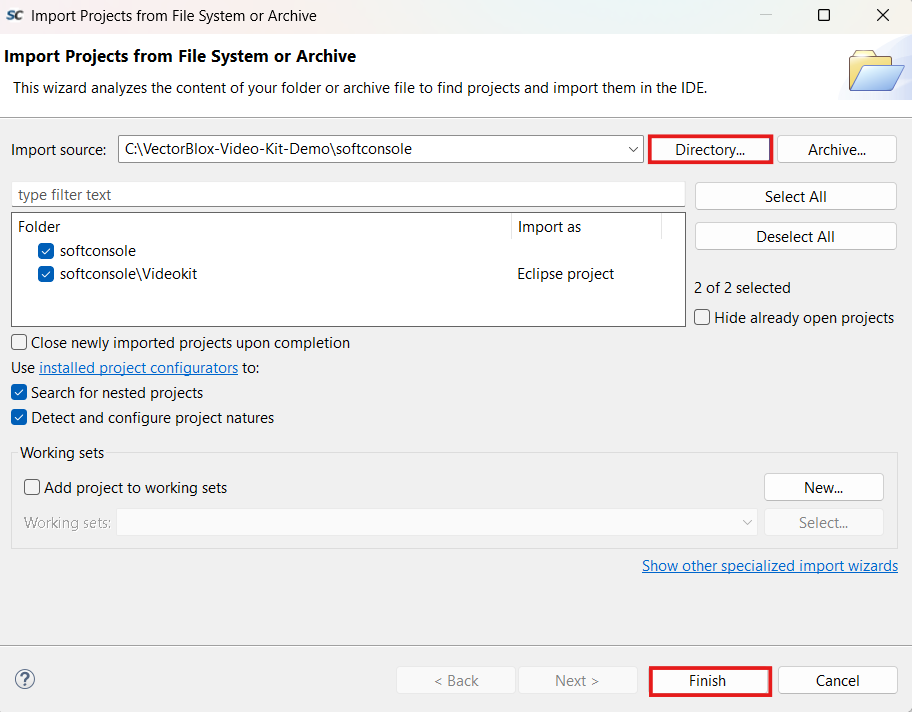
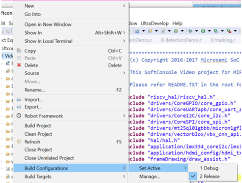

# Modifying the Mi-V Software
The VectorBlox demo application runs bare-metal on a Mi-V RISC-V soft processor within the FPGA fabric. The source code is located in the `softconsole/Videokit` SoftConsole project. The `main.c` file includes the model list, push-button handling, and the main demo loop.

The application is stored in SPI flash and loaded into fabric RAM at power-up. After making changes, you can run it directly from SoftConsole for testing or store it in SPI flash to run automatically at each power-up.

All paths are relative to the directory that contains `MPF_VIDEO_KIT_VECTORBLOX_DESIGN.tcl`.

## Table of Contents

- [Building the Application](#building-the-application)
- [Option A: Run the Application from SoftConsole](#option-a-run-the-application-from-softconsole)
- [Option B: Store the Application in the SPI Flash](#option-b-store-the-application-in-the-spi-flash)
- [Viewing the UART Output](#viewing-the-uart-output)

## Building the Application

### Windows OS

#### Step 1: Create a New Workspace

A SoftConsole workspace is a folder where SoftConsole stores its settings and the list of projects you have open. Use a new, empty workspace for the Videokit project to avoid conflicts with other projects, such as a Videokit project from a previous release.

1. Create an empty folder for the workspace. Keep the path short, for example `C:\vbx\sc_workspace`.
2. Start SoftConsole. When prompted to select a directory as the workspace, click **Browse...** and select the folder you created.
3. Click **Launch**. SoftConsole opens with an empty workspace. Close the **Welcome** tab if it is displayed.

> **Note:** If SoftConsole is already open, select **File > Switch Workspace > Other...**, select the new folder, and click **Launch**. SoftConsole restarts in the new workspace.

#### Step 2: Import the Videokit Project

1. Select **File > Import... > General > Existing Projects into Workspace** and click **Next**.
2. Select **Select root directory**, click **Browse...**, and select the `softconsole/Videokit` directory.
3. Ensure the **Videokit** project is checked and **Copy projects into workspace** is **unchecked**, then click **Finish**.

Alternatively, select **File > Open Projects from File System...**, click **Directory...**, and select the `softconsole` directory. SoftConsole finds the Videokit project inside it. Ensure `softconsole\Videokit` is checked, then click **Finish**.



> **Reference Image:** Importing the Videokit project with **Open Projects from File System**. Click **Directory...** to select the `softconsole` directory, then click **Finish**.

> **Important:** Do not copy the project into the workspace. Libero (through `script_support/RAM.cfg`) expects the build output at `softconsole/Videokit/Release/Videokit.hex`. If the project is copied, SoftConsole builds the copy, and Libero continues to use the old `Videokit.hex` file.

#### Step 3: Build the Project

1. Make the code changes (for example, in `main.c`) and save them.
2. Set the build configuration to `Release`: right-click the **Videokit** project and select **Build Configurations > Set Active > Release**.

   

   > **Reference Image:** Right-click the **Videokit** project, then select **Build Configurations > Set Active > Release**. A check mark appears next to **Release** when it is the active configuration.

3. Right-click the **Videokit** project and select **Build Project**. The output file is `softconsole/Videokit/Release/Videokit.hex`.

### Linux OS

Ensure `riscv64-unknown-elf-gcc` (installed with SoftConsole) is in your `$PATH`, then run:

```bash
make -C softconsole/Videokit/Release all
```

---

## Option A: Run the Application from SoftConsole

Use this option to test changes without reprogramming the SPI flash. The program runs until the board is power-cycled; after a power cycle, the application stored in the SPI flash runs again.

1. Ensure jumper J28 connects pins 1 and 2 to use the on-board FTDI (J12) as the debugger (embedded FlashPro5).
2. In SoftConsole, open **Run > Run Configurations...** and create a debug configuration for the `Videokit` project. Refer to Figure 5-5 in the [VectorBlox Video Kit Demo Guide PDF](./VectorBlox_Video_Kit_Demo_Guide.pdf) as an example.
3. Click **Run**.

---

## Option B: Store the Application in the SPI Flash

Use this option to make your changes load automatically on every power-up. The Fabric RAM client in Libero is configured by `script_support/RAM.cfg` to use `softconsole/Videokit/Release/Videokit.hex`.

If the build is successful, follow these steps:

1. Verify that the timestamp of `softconsole/Videokit/Release/Videokit.hex` is up to date.
2. In Libero, open **Configure Design Initialization Data and Memories**.
3. Click the **Fabric RAMs** tab.
4. Click **Edit** on the entry that uses `softconsole/Videokit/Release/Videokit.hex`. This entry is named `PROC_SUBSYSTEM_0/PF_SRAM_AHBL_AXI_C1_0`.
5. Select your modified `Videokit.hex` file, click **OK**, and then click **Apply**.
6. In the Design Flow window, double-click the **Run PROGRAM_SPI_IMAGE Action**.
7. Power-cycle the board with `SW4`.

> **Note:** Alternatively, run the Tcl script again with the `GENERATE_PROGRAMMING_DATA` argument. The script reads `softconsole/Videokit/Release/Videokit.hex` when it generates the programming data. See the [Building with Libero Setup Guide](./building_with_libero.md).

---

## Viewing the UART Output

The application prints start-up, status, and error messages over UART. Open a serial terminal on the COM port of the J12 USB connection using these settings: 115200 baud, 8 data bits, no parity, 1 stop bit, and no flow control.

If an error occurs, the error message and error code are also written to the HDMI output. For more information on error codes, consult the [CoreVectorBlox IP Handbook](https://github.com/Microchip-Vectorblox/VectorBlox-SDK/blob/master/docs/CoreVectorBlox_IP_Handbook.pdf).
